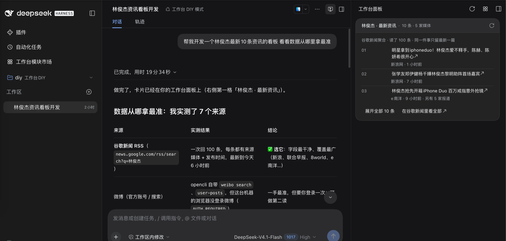

<div align="center">

<h1>dsh-workbench</h1>

<p><strong>看板由你定，操作交给 agent。</strong></p>

<p>dsh-workbench 是 <a href="https://github.com/deepseek-ai/deepseek-harness">DeepSeek Harness</a> 的 Agent 工作台：<br/>
左侧项目与会话，中间常驻对话，右侧一块只读看板。<br/>
看板装什么、开哪些、谁在前，你定；读数据、改状态、造模块，agent 干 —— 动手前先问你。</p>

<p><sub>An agent workbench for DeepSeek Harness — you shape the board, the agent does the work.</sub></p>

<p>
  <a href="https://www.npmjs.com/package/@dsh-workbench/core"></a>
  
  
  
</p>

<p>
  <a href="#30-秒开始"><b>30 秒开始 →</b></a>
  &nbsp;·&nbsp;
  <a href="#三种装法">三种装法</a>
  &nbsp;·&nbsp;
  <a href="#board">看板怎么改</a>
  &nbsp;·&nbsp;
  <a href="#常见问题">常见问题</a>
</p>



</div>

---

## 不是又一个 dashboard，也不是又一个聊天框

| | 传统 dashboard | 纯聊天 | dsh-workbench |
|---|---|---|---|
| 看板谁定 | 厂商定死，加一项等排期 | 没有看板 | 你定：装、开、排、配；没有就让 agent 造 |
| 谁动手 | 你点按钮、填表单 | agent 只在文字里干活 | agent 调工具干活，改之前先问你 |
| 结果在哪 | 另一个窗口，等你刷新 | 聊天记录里翻 | 同屏右栏，改完自己更新 |
| 边界 | 写操作散落在按钮里 | 看不见执行现场 | 只读界面 + 工具写入 + 审批留痕 |

> 界面只读不是能力缺失，是产品判断：**你交代意图，agent 承担操作，界面负责让你看见结果。**

<a id="board"></a>
## 看板由你定：五个动词

| 动词 | 你做什么 |
|---|---|
| **装** | 在「工作台模块市场」装、升、卸模块；装在这台机器上，所有项目共用。 |
| **开** | 每个工作区单独决定开哪几张卡；没配过的跟随机器默认板。 |
| **排** | 拖动调整顺序；也可以直接说一句「把构建挪到最上面」，让 agent 来挪。 |
| **配** | 每块卡片有自己的设置，改完即时生效。 |
| **造** | 没有你要的视角就开 DIY：agent 在工作区里建、写、过门禁、装上去。 |

自定义不等于随便写：界面只读，写入只走 agent 工具，会改数据的先弹审批。

## 和 agent 一起干活：三个同

| 同什么 | 意味着 |
|---|---|
| **同屏** | 对话、卡片、详情并排；不用在聊天和网页之间切来切去。 |
| **同事实** | 看板上的数据 agent 用工具读得到，改完哪张卡会变它知道；你不用复述。 |
| **同权限** | 写入只有一条路：agent 工具 + 审批；谁改的、改了什么，对话里查得到。 |

**适合**：已经在用 DeepSeek Harness 的人；每天在缺陷 / 构建 / 发布之间来回切的人；想给团队造一个内部工作台的人。

## 一次交代，四拍

| 拍 | 发生什么 |
|---|---|
| **交代** | 在对话里说：「把今天的发布风险整理一下，把构建卡片挪到最上面。」 |
| **执行** | agent 读缺陷、查构建、写总结；挪卡片前先问你。 |
| **看见** | 右栏卡片和顺序当场更新；你不用打开另一个窗口，也不用记得点刷新。 |
| **留下** | 它调了哪些工具、改了什么，都在对话里，事后能查。 |

## 三种装法

| 对比项 | **独立实例**（推荐） | **装进 `dsh web`** | **Desktop** |
|---|---|---|---|
| 长什么样 | 自己的 `:3081` 与 profile | 就在 `dsh web` 里多一列看板 | 就在 DeepSeek Harness.app 里多一列看板 |
| 数据 | 会话 / 项目 / 附件跟 web 共用，设置各一份 | 沿用当前会话 | 沿用 Desktop 的会话 |
| 适合 | 想并行、想独立一份设置、想折腾 | 只想多一列看板 | 平时就在 Desktop 里 |

## 30 秒开始

前置：

| 要有 | 为什么 |
|---|---|
| `dsh`（≥ 0.2.1-rc.2） | 本体；更旧的会被拒绝 |
| Node + pnpm | 安装与插件命令需要 |
| Chrome / Edge / Brave / Chromium / Vivaldi | 面板要借你浏览器里的登录状态读数据；第一次打开时在里面装一次 OpenCLI 扩展 |
| 可选：跑过一次 `dsh web` | 想继承它已有的设置 / 插件时；没有也能建 |

```bash
# 交互式：问来源、名字、要不要复制设置
npx @dsh-workbench/core create

# 或直接建默认的 workbench 实例（可重复跑）
npx --yes @dsh-workbench/core@latest setup
npx @dsh-workbench/core
```

打开 <http://localhost:3081>。原来的 `dsh web` 继续用 `:3080`；会话、项目和附件是同一份，
设置与插件各一份。

> **第一次打开还要装一次浏览器扩展**
>
> 工作台会自己装 opencli 的隔离运行时，但**浏览器里的 OpenCLI 扩展要你装一次** —— 面板读的是
> 你浏览器里的登录状态。用 Chrome / Edge / Brave / Chromium / Vivaldi 打开
> [OpenCLI（Chrome 应用商店）](https://chromewebstore.google.com/detail/opencli/ildkmabpimmkaediidaifkhjpohdnifk)
> 装好、确认启用、浏览器保持开着，回「准备工作台」那一屏点「重试」。不装也能点「先进入工作台」，
> 只是要靠登录状态的面板取不到数据。Desktop 的这一屏还多一个「打开浏览器」。

全局装过也可以：`npm i -g @dsh-workbench/core`，然后直接 `dsh-workbench`。
换实例 / 端口：

```bash
npx @dsh-workbench/core --profile wb2
WORKBENCH_PORT=3091 npx @dsh-workbench/core
```

## 装进你现在的 `dsh web`

不想多一个实例、端口、进程：

1. `dsh web` 侧栏 **Plugins → Add plugin**
2. 填 `@dsh-workbench/core`，**Install → Enable now**
3. 刷新页面

装在你当前环境里：会话、存储、附件接着用，不另开一份。之后和独立实例一样用；
细节见 [详细用户指南](packages/core/README.md)。

## 装进 Desktop（DeepSeek Harness.app）

1. 侧栏 **Plugins → Add plugin**
2. 填 `@dsh-workbench/core`，**Install → Enable now**
3. 重开窗口 / 刷新

Desktop 用自己那份配置，**不要跑 `setup`** —— 那会另建一个实例。
装好后模块市场、看板、设置都在，会话沿用 Desktop 的。

Desktop 里个别浏览器调试能力不可用；网页浏览与录制照常。
装模块 / 更新工作台遇到权限或重启提示，退出并重开 Desktop；仍有问题看
[packages/core/README.md](packages/core/README.md) 的常见问题。

三种装法装完后都一样：第一次打开要装一次 **OpenCLI 浏览器扩展**，面板才有数据（见上面的说明与「第一次打开」）。

## 第一次打开

- 首次启动会自己准备运行环境（opencli 的隔离运行时在 `~/.dsh/workbench/opencli`），不改你本机已有的工具配置。
- 浏览器里要装一次 **OpenCLI 扩展**，并保持浏览器开着；「准备工作台」里「浏览器连接」显示已连接才算通。
- 需要登录的平台按卡片提示登录；回来点「重试」。
- 右侧先是一块空看板：去模块市场装，或让 agent 装。
- 失败会说明原因和下一步，不留白屏。

## 模块按需安装

五大动作里的「装」和「造」都在这里：缺陷、构建、分析…在「工作台模块市场」装 / 升 / 卸，
或者直接让 agent 代劳。工作台本身不带业务模块，装什么有什么；装在同一台机器上的模块，
所有项目共用。

想做自己的？开 DIY 模式，让 agent 现场做一个并装上——不用先学一套框架。
具体做法见 [模块 DIY 指引](packages/core/skills/workbench-module-diy/SKILL.md)。

## 数据和设置

- **会话、项目、附件**：三种装法共用一份（都在 `~/.dsh` 下）——在 `:3081` 里接着 web 的对话往下说，不用搬。
  从 1.0.0 之前的独立实例升上来时，旧数据**不会**自动并：先退出所有 dsh，再跑 `dsh-workbench migrate`，或到模块市场「工作台」那一行点「迁移旧数据」。这条提示是非硬性的，点「不再提醒」只收起提示，不会删旧数据。
- **设置与插件**：独立实例是单独一份；装进 `dsh web` / Desktop 就用它们自己的。独立实例可以从 `dsh web` 同步已配好的行。
- **运行时的工具**：opencli、工坊、模块市场仍按 profile 各一份，互不打扰。

## 升级与卸载

- 升级：重跑 `npx --yes @dsh-workbench/core@latest setup`（可重复跑），重启工作台。旧实例的旧会话 / 项目不自动并，需要时跑 `dsh-workbench migrate`。
- 插件页 / Desktop：在市场里更新，提示重启时重开。
- 卸载：插件页移除；独立实例再删 `~/.dsh/profiles/workbench` 与 `~/.dsh/workbench`（会话 / 项目 / 附件在 `~/.dsh` 下，不跟着删）。

## 常见问题

| 症状 | 怎么办 |
|---|---|
| 启动被拒，说 dsh 太旧 | `npm i -g @deepseek-ai/dsh@latest`，再重启工作台 |
| `:3081` 被占 | `WORKBENCH_PORT=3091 npx @dsh-workbench/core` |
| 左栏恢复出厂、右侧看板消失 | 插件被关了；Settings → 插件把 `@dsh-workbench/core` 拨回来，进不去就按 `Meta+,` |
| 自检说浏览器没连上 / 看板取不到数据 | 装一次 [OpenCLI 扩展](https://chromewebstore.google.com/detail/opencli/ildkmabpimmkaediidaifkhjpohdnifk)并启用，保持浏览器开着，回「准备工作台」那一屏点「重试」；Desktop 可点「打开浏览器」 |
| 看板一直空着 / 一直转 | 先确认这个工作区装了模块、平台账号登了、浏览器连接通了；第一次加载可能要几秒 |
| 页面白屏 / 提示插件加载失败 | 多半是插件冲突；重启工作台、检查插件开关，仍不行去仓库开 issue |

## 更多文档

| 想了解 | 读 |
|---|---|
| 完整用户指南 / 首次打开 / 常见问题 | [packages/core/README.md](packages/core/README.md) |
| 文档站（本地起一个看） | [packages/docs/README.md](packages/docs/README.md) |
| 从源码构建、门禁、提交 | [CONTRIBUTING.md](CONTRIBUTING.md) |
| 架构 / 模块协议 | [ARCHITECTURE.md](ARCHITECTURE.md) |
| 写一个模块 | [模块 DIY 指引](packages/core/skills/workbench-module-diy/SKILL.md) |
| 安全 | [SECURITY.md](SECURITY.md) |

## 参与开发

从源码构建、门禁与提交约定见 [CONTRIBUTING](CONTRIBUTING.md)；
架构与模块协议见 [ARCHITECTURE](ARCHITECTURE.md)；文档路由见 [AGENTS](AGENTS.md)。

## License

[MIT](LICENSE)。随仓技能文件另见 [THIRD-PARTY-NOTICES.md](THIRD-PARTY-NOTICES.md)。
