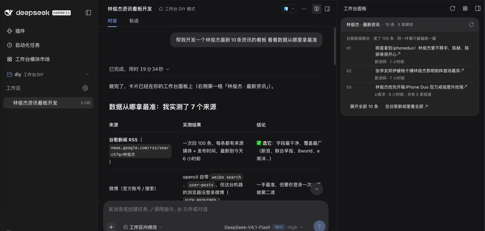

<div align="center">

<h1>dsh-workbench</h1>

<p><strong>看板由你定义。复杂操作，交给 agent。</strong></p>

<p>平台越来越多，工作流越来越碎。<br/>
工作台只取所需，收进一屏：左栏项目与会话，中间常驻对话，右侧一块轻交互看板。<br/>
读取、编排与交付，交给 agent。动手之前，先问你。</p>

<p><sub>An agent workbench — you shape the board, the agent does the work.</sub></p>

<p>
  <a href="https://www.npmjs.com/package/@dsh-workbench/core"></a>
  
  
</p>

<p>
  <a href="#30-秒开始"><b>30 秒开始 →</b></a>
  &nbsp;·&nbsp;
  <a href="#why">为什么是它</a>
  &nbsp;·&nbsp;
  <a href="#三种装法">三种装法</a>
  &nbsp;·&nbsp;
  <a href="#board">看板如何定义</a>
  &nbsp;·&nbsp;
  <a href="#常见问题">常见问题</a>
</p>



</div>

---

<a id="why"></a>
## 平台在扩张，专注在流失

| 日常 | 代价 |
|---|---|
| 在多个平台间登录、查找、比对 | 上下文反复重建，思路一再中断 |
| 功能越堆越多，日常只用两三处 | 菜单、加载、通知，都是干扰 |
| 想拼一个自己的视图 | 等排期，或导出表格手工拼 |
| 想让 AI 参与读取与操作 | 接口不开放，AI 只能停在建议层 |
| 想追溯一次变更 | 记录散落各平台，难以对齐 |

## 取。汇。通。

| | 工作台做的 | 化解 |
|---|---|---|
| **取** | 以模块为界。缺陷、构建、发布、分析，按需而装 | 功能过载 → 只留所需 |
| **汇** | 跨平台数据，汇入同一张看板。按项目开，按你的顺序排 | 多平台 → 一屏 |
| **通** | 即使平台不提供接口，也能读取；写入走看板动作或 agent 工具，留痕可查 | 封闭 → AI 进入工作流 |

平台还是原来的平台。账号、权限、数据，都不迁移。工作台只做一件事：把所需收进一屏，把复杂操作交给 agent。
平台越封闭，这条路越有价值：数据从你已登录的浏览器里来，动作由看板或 agent 发起，写入都有记录。谁改的、改了什么，查得到。

## 不是传统看板。也不是聊天框。

| | 传统看板 | 聊天框 | 工作台 |
|---|---|---|---|
| 看板谁定 | 厂商预设，增项等排期 | 没有看板 | 由你定义。缺什么，让 agent 创建 |
| 谁动手 | 你逐项操作 | agent 只给建议 | 单步动作你按；复杂操作 agent 执行。写入都有记录 |
| 结果在哪 | 另一个窗口，等刷新 | 散在对话记录里 | 同屏右栏，即时更新 |
| 边界 | 写操作散在按钮里 | 执行过程不可见 | 轻交互界面。写入留痕 |

> 看板轻交互，不是能力缺失。是产品判断：**轻交互留在看板，复杂操作交给 agent。**

<a id="board"></a>
## 看板由你定义。五个动作。

| 动作 | 你做什么 |
|---|---|
| **安装** | 安装、更新、卸载模块。模块安装在本机，所有项目共用。 |
| **启用** | 每个项目启用自己需要的模块。 |
| **排序** | 拖动调整顺序，也可以交给 agent。 |
| **配置** | 每个模块都有它的设置。 |
| **创建** | 缺少的视角，让 agent 现场创建。通过检查后再添加到看板。 |

自定义，不等于随意。看板轻交互。写入都有记录。

## 和 agent，一起工作。三个同。

| 同什么 | 意味着 |
|---|---|
| **同屏** | 对话、模块、详情并排。 |
| **同事实** | agent 读取看板数据，知道哪个模块会变。 |
| **同权限** | 写入走看板动作或 agent 工具。谁改的，查得到。 |

**适合谁**：每天要在多个平台之间往返、但每个平台只用两三处功能的人；想让 AI 接手操作，又不愿放弃审批与追溯的人；以及想为团队创建一个内部工作台的人。

## 一次交代，四拍。

| 拍 | 发生什么 |
|---|---|
| **交代** | 「整理今天的发布风险。把构建模块放到最前。」 |
| **执行** | agent 读取缺陷、查看构建、撰写总结。移动模块前会先征得你的同意。 |
| **看见** | 右栏的模块与顺序即时更新。 |
| **留下** | 调了哪些工具，改了什么，都在对话里。 |

## 三种装法

| 对比项 | **独立实例**（推荐） | **装进 `dsh web`** | **Desktop** |
|---|---|---|---|
| 长什么样 | 自己的 `:3081` 与 profile | 就在 `dsh web` 里多一列看板 | 就在 DeepSeek Harness.app 里多一列看板 |
| 数据 | 会话 / 项目 / 附件跟 web 共用，设置各一份 | 沿用当前会话 | 沿用 Desktop 的会话 |
| 适合 | 想并行、想独立一份设置、想折腾 | 只想多一列看板 | 平时就在 Desktop 里 |

## 30 秒开始

前置：

| 要有 | 为什么 |
|---|---|
| `dsh`（≥ 0.2.2-rc.2） | 本体；更旧的会被拒绝 |
| Node + pnpm | 安装与插件命令需要 |
| Chrome / Edge / Brave / Chromium / Vivaldi | 面板要借你浏览器里的登录状态读数据；第一次打开时在里面装一次 OpenCLI 扩展 |
| 可选：跑过一次 `dsh web` | 想继承它已有的设置 / 插件时；没有也能建 |

```bash
# 交互式：问来源、名字、要不要复制设置
npx @dsh-workbench/core create

# 或直接建默认的 workbench 实例（可重复跑）
npx --yes @dsh-workbench/core@latest setup
npx @dsh-workbench/core
```

> **Windows 上走插件页**：独立实例那条路的启动器还是 bash 脚本，`npx @dsh-workbench/core create`
> 与 `setup` 在 Windows 上会报找不到 `bash`。用 `dsh web` 的插件页或 Desktop 的插件页装，效果一样。

打开 <http://localhost:3081>。原来的 `dsh web` 继续使用 `:3080`。两者的会话、项目和附件是同一份，设置与插件各一份。端口写在实例自己的 profile 里，所以用 `dsh-workbench` 或 `dsh workbench` 启动的都是同一个实例、同一个端口；要临时换端口，设置 `WORKBENCH_PORT=3091`。

> **第一次打开还要装一次浏览器扩展**
>
> 工作台会自己安装 opencli 的隔离运行时，但**浏览器里的 OpenCLI 扩展需要你安装一次**，因为面板要读取
> 你浏览器里的登录状态。用 Chrome / Edge / Brave / Chromium / Vivaldi 打开
> [OpenCLI（Chrome 应用商店）](https://chromewebstore.google.com/detail/opencli/ildkmabpimmkaediidaifkhjpohdnifk)，
> 安装并启用后保持浏览器打开，再回到「准备工作台」点「重试」。不安装也能点「先进入工作台」，
> 只是依赖登录状态的面板取不到数据。Desktop 的这一屏还多一个「打开浏览器」。

全局装过也可以：`npm i -g @dsh-workbench/core`，然后直接 `dsh-workbench`。
换实例或端口：

```bash
npx @dsh-workbench/core --profile wb2
WORKBENCH_PORT=3091 npx @dsh-workbench/core
```

## 装进你现在的 `dsh web`

不想多一个实例、端口、进程：

1. `dsh web` 侧栏 **Plugins → Add plugin**
2. 填 `@dsh-workbench/core`，**Install → Enable now**
3. 刷新页面

安装后沿用当前环境：会话、存储、附件继续可用，不会另开一份。之后的使用方式与独立实例相同；
细节见 [详细用户指南](packages/core/README.md)。

## 装进 Desktop（DeepSeek Harness.app）

1. 侧栏 **Plugins → Add plugin**
2. 填 `@dsh-workbench/core`，**Install → Enable now**
3. 重开窗口 / 刷新

Desktop 用自己那份配置，**不要跑 `setup`** —— 那会另建一个实例。
安装完成后，模块市场、看板与设置都会出现，会话沿用 Desktop 的。

Desktop 里个别浏览器调试能力不可用；网页浏览与录制照常。
装模块遇到权限或重启提示，退出并重开 Desktop；仍有问题看
[packages/core/README.md](packages/core/README.md) 的常见问题。

三种装法都一样：首次打开前要在浏览器里安装一次 **OpenCLI 浏览器扩展**，面板才有数据（见上文与「第一次打开」）。

## 第一次打开

- 首次启动会自己准备运行环境（opencli 的隔离运行时在 `~/.dsh/workbench/opencli`），不改你本机已有的工具配置。
- 浏览器里要装一次 **OpenCLI 扩展**，并保持浏览器开着；「准备工作台」里「连接浏览器」那一行显示已连接才算通。
- 需要登录的平台按模块提示登录，完成后回来点击「重试」。
- 右侧初始是一块空看板：到模块市场安装模块，或让 agent 代为安装。
- 失败会说明原因和下一步，不留白屏。

## 模块按需安装

看板五个动作中的「安装」与「创建」都在这里：缺陷、构建、分析等模块可以在「工作台模块市场」安装、升级或卸载，
也可以直接让 agent 代劳。工作台本身不带业务模块，安装什么就有什么；安装在同一台机器上的模块，
所有项目共用。

想自己创建一个？开启 DIY 模式，让 agent 现场创建并安装，不需要先学一套框架。
具体做法见 [模块 DIY 指引](packages/core/skills/workbench-module-diy/SKILL.md)。

## 数据和设置

- **会话、项目、附件**：三种装法共用一份，都放在 `~/.dsh` 下。在 `:3081` 里可以接着 web 的对话继续，不需要迁移。
  从 1.0.0 之前的独立实例升级上来时，旧数据**不会**自动迁移：先退出所有 dsh，再执行 `dsh-workbench migrate`，或到模块市场「工作台」那一行点「迁移旧数据」。这只是一条提示，点「不再提醒」只是不再显示这条提示，不会删除旧数据。
- **设置与插件**：独立实例是单独一份；装进 `dsh web` / Desktop 就用它们自己的。独立实例可以从 `dsh web` 同步已配好的行。
- **运行时的工具**：opencli、工坊、模块市场仍按 profile 各一份，互不打扰。

## 升级与卸载

- 升级：重新执行 `npx --yes @dsh-workbench/core@latest setup`（可重复执行），然后重启工作台。旧实例里的会话与项目不会自动迁移，需要时执行 `dsh-workbench migrate`。
- 更新工作台本身：在模块市场找到「工作台」那一行，点「更新」。新版本会安装到旁边一份独立目录里，
  只修改 profile 中指向它的那几条链接，**不会动正在运行的那一份**。安装完成后会提示「重启后生效」，
  退出再打开一次即可。第一次更新前运行的仍是旧的实体目录，Desktop 上这一次需要先退出工作台
  （界面会提前说明）；之后再更新就不需要了。
  dsh 自带插件页上那条「更新」不是这条路径（它仍会就地覆盖），更新工作台请走市场那一行。
- 卸载：在插件页移除即可。独立实例还需要删除 `~/.dsh/profiles/workbench` 与 `~/.dsh/workbench` 两个目录（会话、项目、附件在 `~/.dsh` 下，不会跟着删除）。

## 常见问题

| 症状 | 怎么办 |
|---|---|
| 启动被拒，提示 dsh 太旧 | 执行 `npm i -g @deepseek-ai/dsh@latest`，再重启工作台 |
| `:3081` 被占 | `WORKBENCH_PORT=3091 npx @dsh-workbench/core`（直接 `dsh workbench` 时同一个变量也认） |
| 左栏恢复出厂、右侧看板消失 | 插件被关闭了。打开 Settings → 插件，重新启用 `@dsh-workbench/core`；进不去就按 `Meta+,` |
| 自检说浏览器未连接 / 看板取不到数据 | 安装一次 [OpenCLI 扩展](https://chromewebstore.google.com/detail/opencli/ildkmabpimmkaediidaifkhjpohdnifk)并启用，保持浏览器打开，再回到「准备工作台」点「重试」；Desktop 可点「打开浏览器」 |
| 看板空白或持续加载 | 依次确认：这个工作区已安装模块、平台账号已登录、浏览器连接正常；第一次加载可能需要几秒 |
| 页面白屏 / 提示插件加载失败 | 多半是插件冲突。重启工作台并检查插件开关；仍未解决就到仓库提交 issue |

## 更多文档

| 想了解 | 读 |
|---|---|
| 完整用户指南 / 首次打开 / 常见问题 | [packages/core/README.md](packages/core/README.md) |
| 文档站（本地起一个看） | [packages/docs/README.md](packages/docs/README.md) |
| 从源码构建、门禁、提交 | [CONTRIBUTING.md](CONTRIBUTING.md) |
| 架构 / 模块协议 | [ARCHITECTURE.md](ARCHITECTURE.md) |
| 写一个模块 | [模块 DIY 指引](packages/core/skills/workbench-module-diy/SKILL.md) |
| 安全 | [SECURITY.md](SECURITY.md) |

## 参与开发

从源码构建、门禁与提交约定见 [CONTRIBUTING](CONTRIBUTING.md)；
架构与模块协议见 [ARCHITECTURE](ARCHITECTURE.md)；文档路由见 [AGENTS](AGENTS.md)。

## License

[MIT](LICENSE)。随仓技能文件另见 [THIRD-PARTY-NOTICES.md](THIRD-PARTY-NOTICES.md)。
