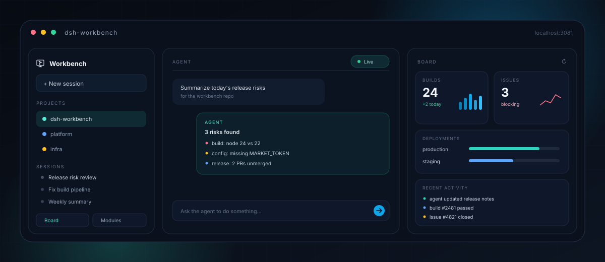

<div align="center">

<h1>dsh-workbench</h1>

<p><strong>把工作交给 agent，把结果留给自己。</strong></p>

<p>dsh-workbench 是 <a href="https://github.com/deepseek-ai/deepseek-harness">DeepSeek Harness</a> 的 Agent 工作台：<br/>
左栏项目与会话，中间常驻对话，右侧实时数据面板 —— 你交代，它执行。</p>

<p><sub>An agent workbench for DeepSeek Harness — tell the agent, watch the result.</sub></p>

<p>
  <a href="https://www.npmjs.com/package/@dsh-workbench/core"></a>
  
  
  
</p>

<p>
  <a href="#30-秒开始"><b>30 秒开始 →</b></a>
  &nbsp;·&nbsp;
  <a href="#三种装法">三种装法</a>
  &nbsp;·&nbsp;
  <a href="#模块按需安装">模块</a>
  &nbsp;·&nbsp;
  <a href="#常见问题">常见问题</a>
</p>



</div>

---

## 不是又一个 dashboard

| 传统 dashboard | dsh-workbench |
|---|---|
| 你找按钮、填表单、等刷新 | 你**说一句话**，agent 去做 |
| 对话和面板是两个窗口 | 对话在中间，数据在右边，**始终同屏** |
| 每加一个数据源就多一套 UI | **装一个模块**，或者让 agent 现场造一个 |
| 业务写操作散落在各个按钮里 | 业务写操作只有一条路：**agent 工具 + 审批** |

> 界面只读不是能力缺失，是产品判断：**你交代意图，agent 承担操作，界面负责让你看见结果。**

## 为什么你会留下

| 你会得到 | 说明 |
|---|---|
| **对话不离场** | 看板、卡片、详情都在右栏；不用在聊天和网页之间切来切去。 |
| **数据自己会动** | agent 改完，面板自己更新；不用手动刷新。 |
| **能力按需装** | 缺陷、构建、分析…装哪个来哪个，不背一整套用不上的东西。 |
| **该问的写会先问你** | 涉及写的能力会先让你确认，不会悄悄改掉什么。 |

**适合**：已经在用 DeepSeek Harness 的人；每天在缺陷 / 构建 / 发布之间来回切的人；想给团队造一个内部工作台的人。

## 一张工作台，三种节奏

| 节奏 | 发生什么 |
|---|---|
| **交代** | 在对话里说：「把今天的发布风险整理一下。」 |
| **执行** | agent 去读缺陷、查构建、写总结。 |
| **看见** | 右栏卡片和详情随之更新；你不用打开另一个窗口，也不用记得点刷新。 |

## 三种装法

| 对比项 | **独立实例**（推荐） | **装进 `dsh web`** | **Desktop** |
|---|---|---|---|
| 长什么样 | 自己的 `:3081`，数据独立 | 就在 `dsh web` 里多一列面板 | 就在 DeepSeek Harness.app 里多一列面板 |
| 数据 | 与 web 互不影响 | 沿用当前会话 | 沿用 Desktop 的会话 |
| 适合 | 想并行、想隔离、想折腾 | 只想多一列面板 | 平时就在 Desktop 里 |

## 30 秒开始

前置三条：

| 要有 | 为什么 |
|---|---|
| `dsh`（≥ 0.2.1-rc.2） | 本体；更旧的会被拒绝 |
| Node + pnpm | 安装与插件命令需要 |
| 可选：跑过一次 `dsh web` | 想继承它已有的设置 / 插件 / 项目时；没有也能建 |

```bash
# 交互式：问来源、名字、要复制哪些内容
npx @dsh-workbench/core create

# 或直接建默认的 workbench 实例（可重复跑）
npx --yes @dsh-workbench/core@latest setup
npx @dsh-workbench/core
```

打开 <http://localhost:3081>。原来的 `dsh web` 继续用 `:3080`，两边互不影响。

全局装过也可以：`npm i -g @dsh-workbench/core`，然后直接 `dsh-workbench`。
换实例 / 端口：

```bash
npx @dsh-workbench/core --profile wb2
WORKBENCH_PORT=3091 npx @dsh-workbench/core
```

## 装进你现在的 `dsh web`

不想多一个实例、端口、进程：

1. `dsh web` 侧栏 **Plugins → Add plugin**
2. 填 `@dsh-workbench/core`，**Install → Enable now**
3. 刷新页面

装在你当前环境里：会话、存储、附件接着用，不另开一份。之后和独立实例一样用；
细节见 [详细用户指南](packages/workbench/README.md)。

## 装进 Desktop（DeepSeek Harness.app）

1. 侧栏 **Plugins → Add plugin**
2. 填 `@dsh-workbench/core`，**Install → Enable now**
3. 重开窗口 / 刷新

Desktop 用自己那份配置，**不要跑 `setup`** —— 那会另建一个实例。
装好后模块市场、面板、设置都在，会话沿用 Desktop 的。

Desktop 里个别浏览器调试能力不可用；网页浏览与录制照常。
装模块 / 更新工作台遇到权限或重启提示，退出并重开 Desktop；仍有问题看
[packages/workbench/README.md](packages/workbench/README.md) 的常见问题。

## 第一次打开

- 首次启动会自己准备运行环境，不改你本机已有的工具配置。
- 需要登录的平台按卡片提示登录；回来点「重试」。
- 右侧先是一块空看板：去模块市场装，或让 agent 装。
- 失败会说明原因和下一步，不留白屏。

## 模块按需安装

面板能力是独立模块：缺陷、构建、分析…在「工作台模块市场」装 / 升 / 卸，
或者直接让 agent 代劳。工作台本身不带业务模块，装什么有什么。

想做自己的？开 DIY 模式，让 agent 现场做一个并装上——不用先学一套框架。
具体做法见 [模块 DIY 指引](packages/workbench/skills/workbench-module-diy/SKILL.md)。

## 数据和设置

- **独立实例与 `dsh web` 互不影响**：各自会话、各自设置，只有登录凭据共用。
- **装进 `dsh web` / Desktop**：会话沿用当前的，不另开一份。
- **设置**：独立实例在 `:3081` 的 Settings；装进 `dsh web` / Desktop 就在各自设置里。独立实例可以从 `dsh web` 同步已配好的行。

## 升级与卸载

- 升级：重跑 `npx --yes @dsh-workbench/core@latest setup`（可重复跑），重启工作台。
- 插件页 / Desktop：在市场里更新，提示重启时重开。
- 卸载：插件页移除；独立实例再删工作台自己的数据目录。

## 常见问题

| 症状 | 怎么办 |
|---|---|
| 启动被拒，说 dsh 太旧 | `npm i -g @deepseek-ai/dsh@latest`，再重启工作台 |
| `:3081` 被占 | `WORKBENCH_PORT=3091 npx @dsh-workbench/core` |
| 左栏恢复出厂、右侧面板消失 | 插件被关了；Settings → 插件把 `@dsh-workbench/core` 拨回来，进不去就按 `Meta+,` |
| 面板一直空着 / 一直转 | 先确认这个工作区装了模块、平台账号登了；第一次加载可能要几秒 |
| 页面白屏 / 提示插件加载失败 | 多半是插件冲突；重启工作台、检查插件开关，仍不行去仓库开 issue |

## 更多文档

| 想了解 | 读 |
|---|---|
| 完整用户指南 / 首次打开 / 常见问题 | [packages/workbench/README.md](packages/workbench/README.md) |
| 文档站（本地起一个看） | [packages/docs/README.md](packages/docs/README.md) |
| 从源码构建、门禁、提交 | [CONTRIBUTING.md](CONTRIBUTING.md) |
| 架构 / 模块协议 | [ARCHITECTURE.md](ARCHITECTURE.md) |
| 写一个模块 | [模块 DIY 指引](packages/workbench/skills/workbench-module-diy/SKILL.md) |
| 安全 | [SECURITY.md](SECURITY.md) |

## 参与开发

从源码构建、门禁与提交约定见 [CONTRIBUTING](CONTRIBUTING.md)；
架构与模块协议见 [ARCHITECTURE](ARCHITECTURE.md)；文档路由见 [AGENTS](AGENTS.md)。

## License

[MIT](LICENSE)。随仓技能文件另见 [THIRD-PARTY-NOTICES.md](THIRD-PARTY-NOTICES.md)。
