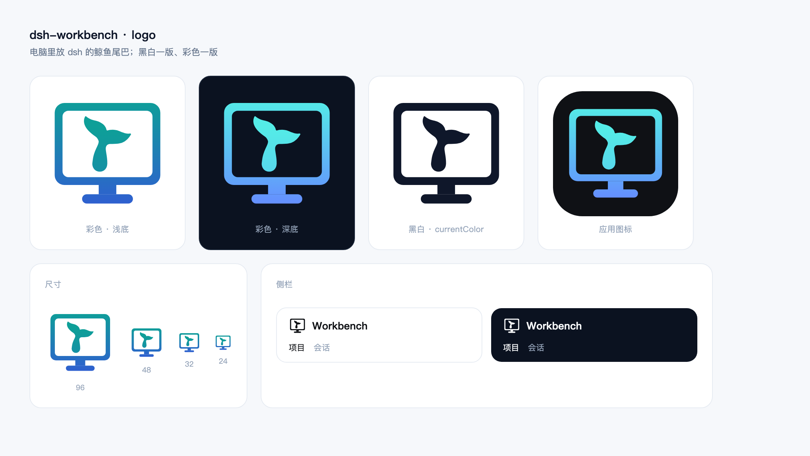

# logo

工作台的标：一台显示器里放着 dsh 的鲸鱼尾巴，黑白一版、彩色一版。

| 文件 | 用在哪 |
|---|---|
| [`logo-mono.svg`](logo-mono.svg) | 单色（`currentColor`）：侧栏品牌位、跟着文字色走的地方 |
| [`logo-color.svg`](logo-color.svg) | 彩色，浅底 |
| [`logo-color-dark.svg`](logo-color-dark.svg) | 彩色，深底 |
| [`logo-app.svg`](logo-app.svg) | 深色圆角方：插件卡片、应用图标 |

- 彩色是青→蓝渐变，跟 dsh 插件图同一套色（`#54ECE7 → #658EFF`）；浅底压深成 `#0E9F98 → #2F5FD0`，白底上才够清楚。
- 几何走 64 网格：显示器 5–59 × 6–48，屏幕 9–55 × 10–44，尾巴在屏幕里居中，缩放 1.95。
- 尾巴取自 dsh 的 running whale（`@deepseek-ai/dsh-client-ui-chat` 的 `REST_PATH`），填成实心、底部收圆；鲸鱼标归 DeepSeek，这里是派生出来的项目自用标。

插件图标 `packages/workbench/icon.svg` 与 [`logo-app.svg`](logo-app.svg) 是同一份；侧栏位用 `@dsh-workbench/shared` 里 `IconBrandMark` 的同形单色版。
