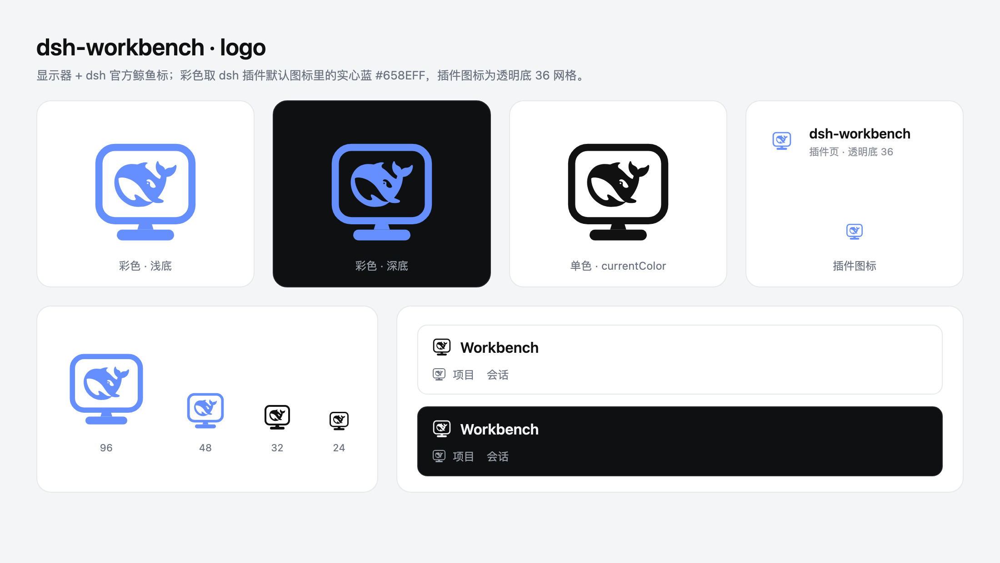

# logo

工作台的标：一台显示器，屏幕里放着 dsh 官方的鲸鱼标；黑白一版、彩色一版。

| 文件 | 用在哪 |
|---|---|
| [`logo-mono.svg`](logo-mono.svg) | 单色（`currentColor`）：侧栏品牌位、启动页、跟着文字色走的地方 |
| [`logo-color.svg`](logo-color.svg) | 彩色，浅底 |
| [`logo-color-dark.svg`](logo-color-dark.svg) | 彩色，深底 |
| [`logo-app.svg`](logo-app.svg) | 透明底的插件图标（36 网格、内容 8–28）：dsh 插件页 |

- 几何走 64 网格：屏幕 6–58 × 6–47、圆角 9、4 宽描边不填色；脖子从 29–35 收到 27.5–36.5，底座 16–48 × 52–58、圆角 3；鲸鱼实心。
- 彩色跟 dsh 内置插件图标同一套蓝：框走渐变，深底 `#67C7FE → #3F77D8`（内置图标里最常用的一对，推荐/市场/语音/插件市场都是它），浅底压深成 `#5BB8FF → #3565DD`；鲸鱼再压一档成实心 `#2F5FD8`，跟框拉开层次。
- 鲸鱼是 dsh 官方标 `FishLogo`（`@deepseek-ai/dsh-client-ui-primitives`，23.16×17.04，侧身那条），1.5 倍、落在 (32, 26.5)，不镜像、不改形；鲸鱼标归 DeepSeek。
- 单色版与彩色版共用同一套几何（`packages/shared/src/components/icons.tsx` 的 `BRAND_BODY` / `BRAND_NECK` / `BRAND_BASE` / `BRAND_WHALE`）：线框和鲸鱼都吃 `currentColor`。
- 文档站那份（`packages/docs/site/static/logo.svg`）同形，换成文档站的紫：框 `#B39AFF → #7F8BF7`，鲸鱼 `#6F63EA`。

插件图标 `packages/core/icon.svg` 与 [`logo-app.svg`](logo-app.svg) 是同一份，透明底、跟 dsh 内置插件图标同规格（36 网格、内容占 8–28），亮色模式下不会留一块黑底；侧栏位用 `@dsh-workbench/shared` 里 `IconBrandMark` 的同形单色版，市场里工作台那一行用彩色版 `IconBrandMarkColor`（颜色写死，不跟主题走）。
